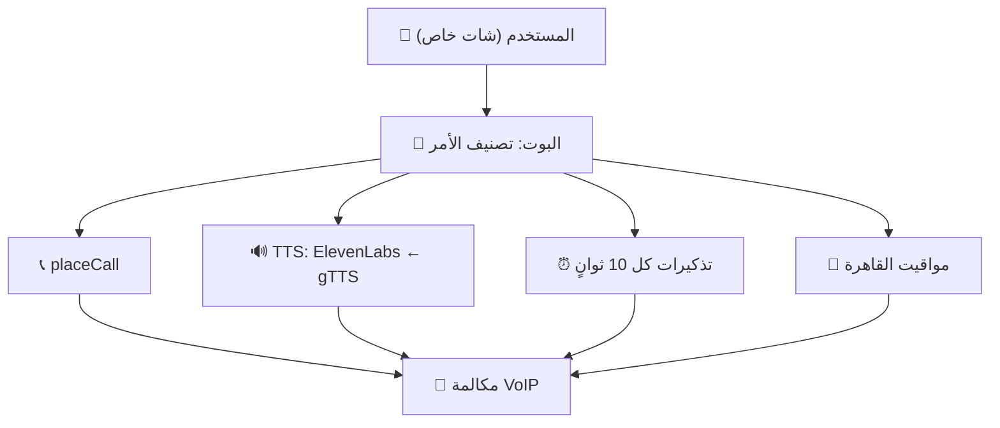
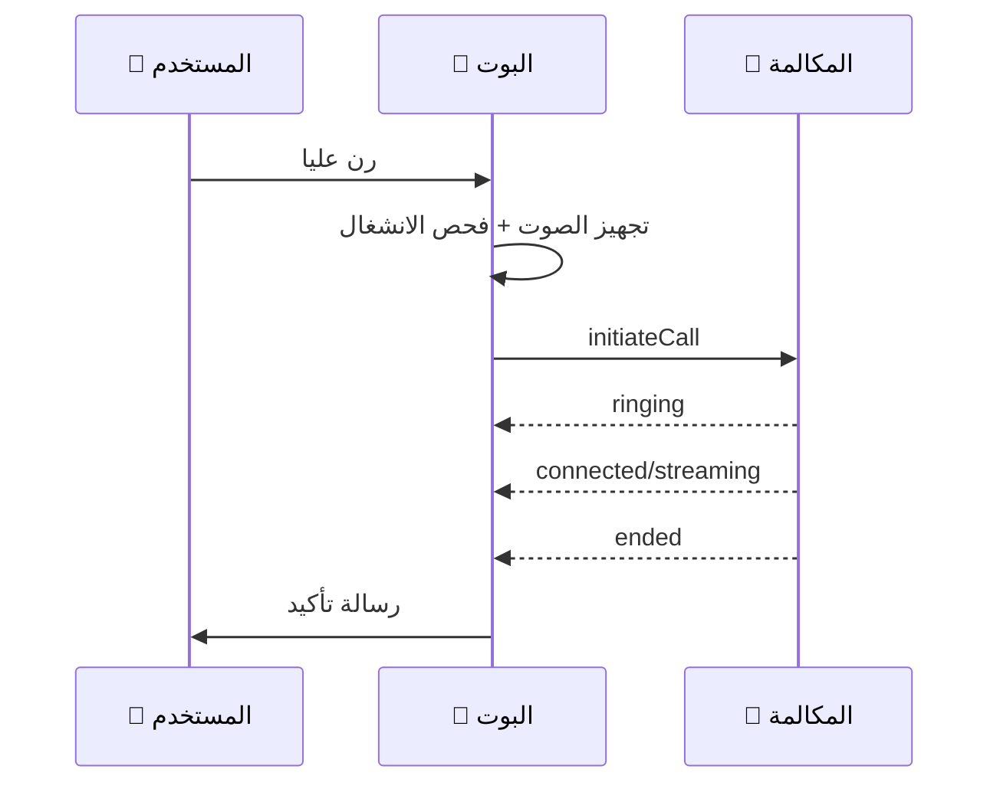
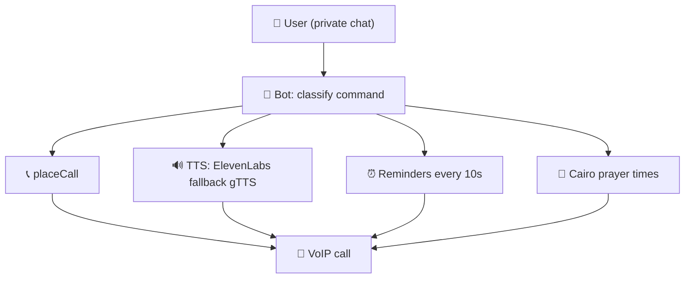
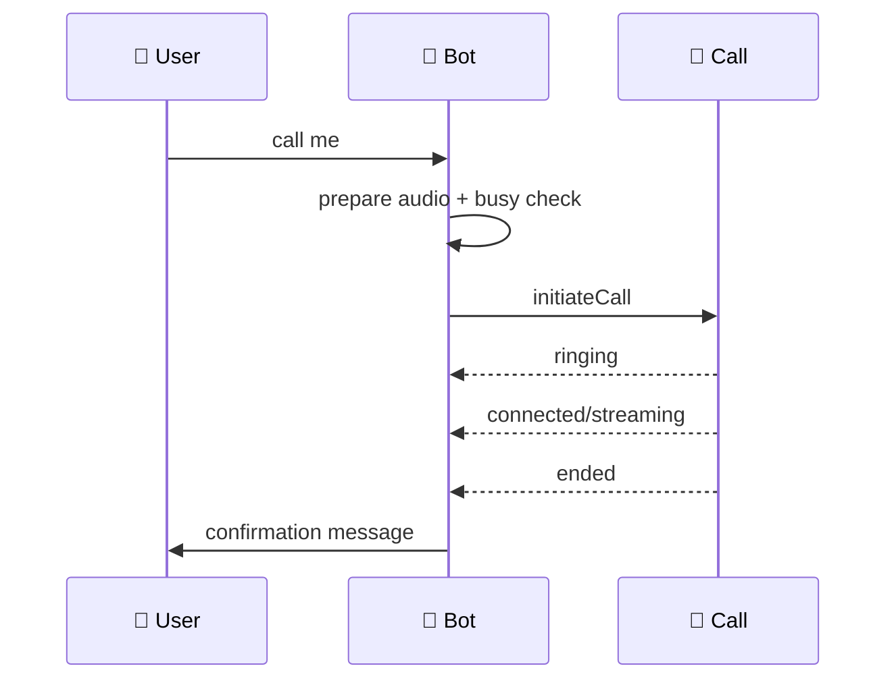

<div align="center">


# 📞 WHATSAPP CALL BOT

### بوت واتساب بالمكالمات الصوتية — WhatsApp Voice Call Bot

[](./LICENSE)
[](https://nodejs.org/)
[](https://github.com/innovatorssoft/Baileys)
[](https://elevenlabs.io/)

**ابعت "رن عليا" في الشات الخاص والبوت يتصل بيك ويشغل الصوت — مع تذكيرات ومواقيت صلاة.**

**Send "call me" in private chat and the bot calls you with audio — plus reminders and prayer times.**

</div>

---

<div align="center">

## 🌍 اختار اللغة — Choose Language

### [🇪🇬 العربية](#-النسخة-العربية) &nbsp;&nbsp;|&nbsp;&nbsp; [🇬🇧 English](#-english-version)

</div>

---

<a id="-النسخة-العربية"></a>

<div dir="rtl">

## 🇪🇬 النسخة العربية

### 📖 الفكرة

**WhatsApp Call Bot** بوت واتساب شخصي بمكالمات صوتية (VoIP) عبر مكتبة Baileys الداعمة للمكالمات: أوامر **رن عليا**، **اتصل وقول** (تحويل النص لصوت)، **تذكيرات** برسالة أو بمكالمة، و**تذكير الصلاة** بمكالمة فيها الأذان كامل. الربط برقم الهاتف (Pairing Code) من غير QR.

### 🏗️ المعمارية



### 🔄 مسار المكالمة



### ✨ المميزات

- 📞 مكالمة مباشرة بملف صوتي + حد أقصى 3 مكالمات متزامنة
- 🔊 تحويل النص لصوت (ElevenLabs ثم gTTS تلقائيًا) بمدة محسوبة
- ⏰ تذكيرات مرنة (نسبي/مطلق/بكرة/بعد بكرة) برسالة أو بمكالمة
- 🕌 مواقيت القاهرة (طريقة 5) + مكالمة أذان كاملة (~3:16)
- 🔒 خاص فقط — يتجاهل الجروبات والقنوات والحالات
- 🛠️ `ensure-deps.js` يثبت الناقص + `prune.js` لتقليم الحزم

### ⌨️ الأوامر

| الأمر | الوظيفة |
|---|---|
| `رن عليا` / `call me` | مكالمة بملف `audio.mp3` |
| `اتصل وقول "..."` | TTS + مكالمة بمدة تلقائية |
| `ذكرني ...` | تذكير برسالة (صيغ وقت كثيرة) |
| `... بمكالمة وقول ...` | رسالة + مكالمة منطوقة |
| `ذكرني قائمة/الغاء` | إدارة التذكيرات |
| `صلاة تفعيل/الغاء/حالة` | تذكير الصلاة والمكالمات |
| `مساعدة` / `help` | كل الأوامر بالشرح |

### 🛠️ جدول التقنيات

| المكون | التقنية | الدور |
|---|---|---|
| الواتساب | Baileys ‏(VoIP fork) | اتصال + مكالمات + pairing |
| الصوت | ElevenLabs ← gTTS ‏(Python) | تحويل النص لصوت |
| الصوتيات | FFmpeg + ffprobe | تحويل وقياس المدد |
| التخزين | ملفات JSON محلية | تذكيرات + صلاة |
| المواقيت | Aladhan API ‏(القاهرة) | حساب الصلوات |
| اللوق | pino + ملف يومي | متابعة وتشخيص |

### 📚 المكتبة المستخدمة

المشروع مبني على **نسخة معدلة** من Baileys: [`@innovatorssoft/baileys`](https://github.com/innovatorssoft/Baileys) ‏(v7.4.9) — مضاف إليها نظام **VoIP كامل** (مكالمات صوت عبر WebRTC) غير موجود في النسخة الأصلية (WhiskeySockets). ملحوظة: مدة المكالمة في المكتبة تُحسب شاملة وقت الرن، لذلك البوت يضيف `RING_BUDGET_MS` تلقائيًا.

النسخة المعدلة كبيرة (~282MB مع اعتمادياتها) لأنها مبنية لأغراض كثيرة لا يحتاجها البوت — سكريبت `prune.js` يمسح الأجزاء الزائدة من `node_modules` (مستندات واختبارات وملفات لا تعمل وقت التشغيل) لتقليل المساحة:

```bash
npm run prune -- --dry-run   # معاينة فقط
npm run prune                # تنفيذ المسح
```

### 🚀 التشغيل

```bash
# 1. ثبّت الاعتماديات
npm install
pip install -r requirements.txt

# 2. انسخ البيئة واملأها
copy .env.example .env
# PHONE_NUMBER=2010xxxxxxxx (بدون +) + ELEVENLABS_API_KEY (اختياري)

# 3. شغّل (يثبت أي ناقص تلقائيًا)
npm start

# 4. اربط من الموبايل: واتساب ← الأجهزة المرتبطة ← ربط برقم الهاتف
# 5. اختبار الصوت: node index.js --test-tts "نص تجريبي"

# تقليم الحزم لتوفير المساحة (معاينة أولًا):
npm run prune -- --dry-run
```

### 📁 الهيكل

```
whatsapp-call-bot/
├── index.js          # الاتصال + الربط + راوتر الأوامر
├── lib/
│   ├── call.js       # placeCall (مكالمة واحدة لكل رقم)
│   ├── tts.js        # ElevenLabs ← gTTS + قياس المدة
│   ├── reminders.js  # التذكيرات (فحص كل 10 ثوانٍ)
│   ├── prayer.js     # مواقيت القاهرة + مكالمة الأذان
│   ├── text.js       # تطبيع العربي
│   └── logger.js     # اللوق
├── ensure-deps.js    # تثبيت تلقائي للناقص
├── prune.js          # تقليم node_modules
├── adhan.mp3         # صوت الأذان • audio.mp3 (ملف المكالمة)
├── logo.svg          # اللوجو
└── .env.example      # قالب المتغيرات
```

### 🔧 حل المشاكل

| المشكلة | الحل |
|---|---|
| خطأ 401/428/429 | تحقق من الجلسة والربط والحدود |
| لا صوت | تأكد من FFmpeg و`audio.mp3` |
| TTS فشل | يتحول لـ gTTS تلقائيًا (يحتاج بايثون) |
| جلسة منتهية | امسح `auth/` وأعد الربط |

</div>

---

<a id="-english-version"></a>

## 🇬🇧 English Version

### 📖 Overview

**WhatsApp Call Bot** is a personal WhatsApp voice-call (VoIP) bot on a call-capable Baileys fork: **call me** commands, **call-and-say** (text-to-speech), **reminders** by message or call, and **prayer-time** reminders with a full-adhan call. Links via phone Pairing Code, no QR.

### 🏗️ Architecture



### 🔄 Call Flow



### ✨ Features

- 📞 Direct call with audio file + max 3 concurrent calls
- 🔊 Text-to-speech (ElevenLabs then gTTS automatically) with measured duration
- ⏰ Flexible reminders (relative/absolute/tomorrow/day-after) by message or call
- 🕌 Cairo prayer times (method 5) + full-adhan call (~3:16)
- 🔒 Private chat only — ignores groups/channels/status
- 🛠️ `ensure-deps.js` auto-installs + `prune.js` trims packages

### ⌨️ Commands

| Command | Function |
|---|---|
| `call me` / `رن عليا` | Call playing `audio.mp3` |
| `call and say "..."` | TTS + call with auto duration |
| `remind me ...` | Message reminder (many time formats) |
| `... with a call saying ...` | Message + spoken call |
| `remind list/cancel` | Manage reminders |
| `prayer on/off/status` | Prayer reminders and calls |
| `help` / `commands` | Full bilingual command list |

### 🛠️ Stack Table

| Component | Tech | Role |
|---|---|---|
| WhatsApp | Baileys (VoIP fork) | Connection + calls + pairing |
| Voice | ElevenLabs → gTTS (Python) | Text-to-speech |
| Audio | FFmpeg + ffprobe | Convert + measure durations |
| Storage | Local JSON files | Reminders + prayer |
| Times | Aladhan API (Cairo) | Prayer calculation |
| Logging | pino + daily file | Monitoring |

### 📚 Library Used

The project runs on a **modified fork** of Baileys: [`@innovatorssoft/baileys`](https://github.com/innovatorssoft/Baileys) (v7.4.9) — with a full **VoIP system** (voice calls over WebRTC) that the original (WhiskeySockets) doesn't have. Note: the library counts call duration including ring time, so the bot adds `RING_BUDGET_MS` automatically.

The modified fork is big (~282MB with dependencies) because it targets many uses the bot doesn't need — `prune.js` removes the excess parts of `node_modules` (docs, tests, non-runtime files) to save disk space:

```bash
npm run prune -- --dry-run   # preview only
npm run prune                # actually delete
```

### 🚀 Run

```bash
# 1. Install dependencies
npm install
pip install -r requirements.txt

# 2. Copy env and fill it
copy .env.example .env
# PHONE_NUMBER=2010xxxxxxxx (no +) + ELEVENLABS_API_KEY (optional)

# 3. Start (auto-installs anything missing)
npm start

# 4. Link from phone: WhatsApp → Linked Devices → Link with phone number
# 5. Voice test: node index.js --test-tts "test text"

# Trim packages to save disk space (preview first):
npm run prune -- --dry-run
```

### 📁 Structure

```
whatsapp-call-bot/
├── index.js          # Connection + pairing + command router
├── lib/
│   ├── call.js       # placeCall (single-flight per JID)
│   ├── tts.js        # ElevenLabs → gTTS + duration probe
│   ├── reminders.js  # Reminders (10s checker)
│   ├── prayer.js     # Cairo times + adhan call
│   ├── text.js       # Arabic normalization
│   └── logger.js     # Logging
├── ensure-deps.js    # Missing-dep auto installer
├── prune.js          # node_modules trimmer
├── adhan.mp3         # Adhan audio • audio.mp3 (call file)
├── logo.svg          # Logo
└── .env.example      # Env template
```

### 🔧 Troubleshooting

| Problem | Fix |
|---|---|
| 401/428/429 errors | Check session, pairing and limits |
| No audio | Verify FFmpeg and `audio.mp3` |
| TTS failed | Auto-falls-back to gTTS (needs Python) |
| Dead session | Delete `auth/` and re-link |

---

<div align="center">

### [⬆️ back to top / العودة للأعلى](#-whatsapp-call-bot)

MIT License. WhatsApp glyph by Simple Icons (CC0).

</div>
